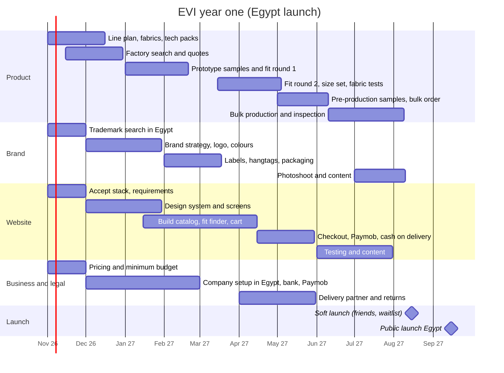

# Roadmap, year one

Target: **soft launch in Egypt in August 2027, public launch in September 2027.** Product sampling and the
website run in parallel from November 2026. Dates are planning targets and will move once factory lead
times are known.

## Constraints (decided 2026-10-23 and 2026-10-28)

| Constraint | Decision | What it means for the plan |
| --- | --- | --- |
| Launch market | **Egypt first**; the Gulf later | One currency (EGP), local delivery, cash on delivery; Gulf pricing and shipping later |
| Founder location | Lives in Kuwait; company and production in Egypt | Samples travel by courier to Kuwait, or a trusted person in Egypt visits factories |
| Budget | The minimum needed; amount not set yet | Small first range and small quantities; budget estimate in the business analysis |
| Prices | Maximums set in KD; proposed Egypt prices in `docs/03-business/pricing.md` | Target costs per item guide factory quotes |
| Founder time | About 2 hours a day | Claude prepares documents and decisions; the founder reviews, decides, wears samples, and talks to suppliers |
| Customer research | No survey or interviews for now | Desk research and competitor reviews now; private conversations later |
| Domain and Instagram | Later | Start locally; secure them before the public launch |
| Launch scope | A full basics wardrobe: tops, pants, jackets, blazers, enough to mix and match for a week | Gym wear moves to drop 2 |

## Four tracks in parallel

## Month by month

| Month | Product | Brand | Website | Business and legal |
| --- | --- | --- | --- | --- |
| Nov 2026 | Line plan for the launch range; fabric brief; body-shape fit approach; tech packs for the first 3–4 key styles | Trademark search for EVI in Egypt | Accept the stack; requirements and user stories | Pricing (draft done); minimum budget estimate |
| Dec 2026 | Factory and fabric search in Egypt; quotes; fabric swatches | Brand strategy, logo concepts | Design system; key screens | Start company registration |
| Jan 2027 | Prototype samples for key styles | Logo and colours final | Build starts: catalog, product page, size guide | — |
| Feb 2027 | Fit round 1 (before Ramadan slows factories) | Labels and hangtags | Body-shape finder, outfit builder | Bank account |
| Mar 2027 | Samples for the rest of the range | Packaging | Cart, account, Arabic and English | Paymob merchant account |
| Apr 2027 | Fit round 2; size set; fabric lab tests | — | Checkout with Paymob and cash on delivery | Delivery partner chosen |
| May 2027 | Pre-production samples approved; bulk order | — | Admin, order flow, emails | Returns policy, terms, privacy |
| Jun 2027 | Bulk production | — | End-to-end testing | — |
| Jul 2027 | Production; quality inspection | Photoshoot; product content | Product pages filled | Stock received and counted |
| Aug 2027 | — | Soft-launch content | Soft launch to friends and a waitlist | — |
| Sep 2027 | — | Launch campaign | **Public launch in Egypt** | First results reviewed |

## Phase checkpoints

| By | Checkpoint |
| --- | --- |
| End Nov 2026 | Line plan approved; trademark search clear; stack accepted |
| End Jan 2027 | Factories chosen; first prototypes in hand; logo approved |
| End Apr 2027 | All launch styles pass fit and fabric tests; the founder has worn and approved each |
| End May 2027 | Bulk order placed within budget |
| End Jul 2027 | Website tested end to end with real orders |

## Later (after launch)

- Gulf launch (Kuwait and Saudi Arabia first, to decide)
- Colour drops every 2–3 months, mixing with the core range
- Gym wear (drop 2), more body-shape fits, hijabs
- Men's line
- A physical store, if online demand supports it

## Calendar to plan around (approximate)

- Ramadan 2027: about 8 Feb – 9 Mar; Eid al-Fitr about 10 Mar. Factories slow down; get prototypes before.
- Eid al-Adha 2027: about 16 May.
- Egyptian public holidays and summer heat affect factory schedules; confirm with each factory.
