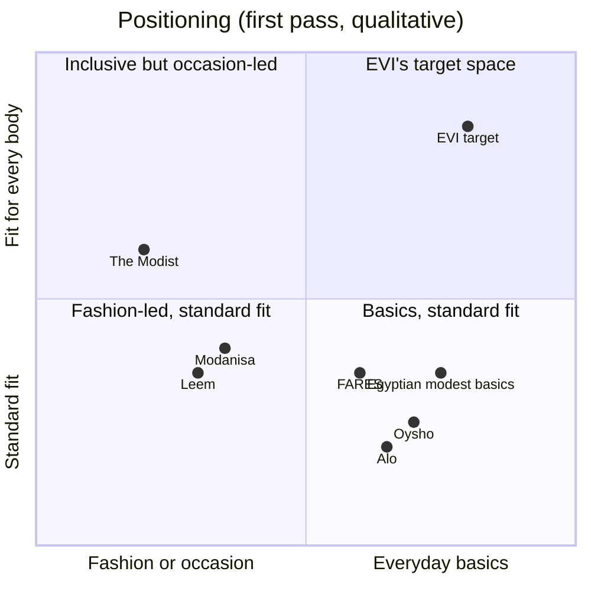

# Competitor matrix

First pass from secondary sources (press, brand and retailer pages). Detailed teardowns follow in
`competitors/`. Sources are in `sources.md`.

| Competitor | Type | Markets | What they sell | Modest by design | Size range / fit | Price level | Notes |
| --- | --- | --- | --- | --- | --- | --- | --- |
| **Oysho** (Inditex) | Global leisure and loungewear | Saudi Arabia and UAE (Alhokair, reported 2017), other Gulf markets (Azadea), Egypt malls | Sport, leisure, loungewear, underwear | No | Standard | Mid | One of the founder's reference brands |
| **Alo** | Global premium athleisure | Kuwait (2022), Dubai, Qatar, Abu Dhabi (2024) via Alshaya; Saudi Arabia not confirmed | Yoga and lifestyle wear | No | Standard | Premium | One of the founder's reference brands |
| **Namshi, Noon** | Marketplaces | Gulf | "Modest" edits of many brands (Khizana, Modanisa, others) | Mixed | Mixed | Low to mid | Possible sales channel later |
| **Ounass** | Luxury marketplace | Gulf | "Modest style" edit of luxury brands | Mixed | Mixed | Luxury | — |
| **Modanisa** | Turkish modest e-retailer | Global; Gulf via Namshi | Wide modest range | Yes | Mixed | Low to mid | Large catalogue, not a basics system |
| **FARES** | Modest brand | Saudi Arabia (reported) | "Everyday elegance" modest wear with a Basics category | Yes | Unknown | Unknown | Closest positioning found; needs a teardown |
| **Leem** | Saudi modest brand | Saudi Arabia | Maxi dresses, separates, knits | Yes | Unknown | Mid to premium | More elevated than basics |
| **Tema** | Egyptian modest brand | Egypt | Long suits, hoodie dresses, long shirts; COD | Yes | Unknown | About EGP 1,650 per suit | — |
| **Jamila** | Egyptian hijab and basics brand | Egypt | Long-sleeve high-neck tops from EGP 375, scarves | Yes | Unknown | Low to mid | — |
| **Rizq**, **Hayaa**, **Jeepa**, **Main's**, **Fabric Tales** | Egyptian modest brands | Egypt | Hijab-friendly casual basics, long tops, wide pants | Yes | Unknown | Rizq EGP 580–1,100 | Listed in 2025 local guides |
| **The Modist** (Dima Ayad) | Modest luxury | Dubai | Kaftans, kimonos, tops | Yes | Shown on plus-size models | Luxury | Plus-size visibility, not basics |
| **MULU** | Dutch plus-size brand | Moved base to Dubai | Plus-size fashion | No | Plus-size | Mid | Shows plus-size demand in the region |

## Positioning map

Placements are qualitative judgements from the sources above, to be refined by the teardowns.
